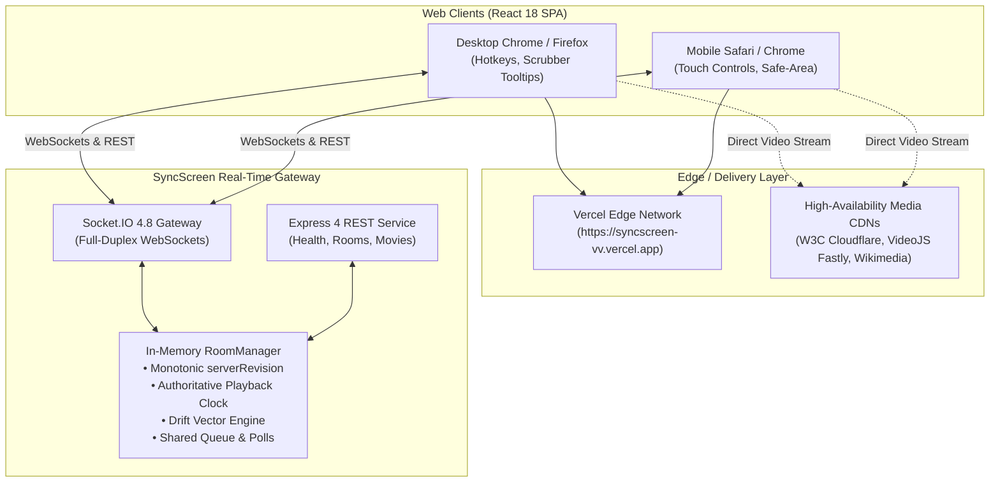

# SyncScreen-VV — Deployment & Quality Assurance Report

**Project:** SyncScreen Real-Time Multi-User Watch Party  
**GitHub Repository:** [https://github.com/SarveshS1407/SyncScreen-VV](https://github.com/SarveshS1407/SyncScreen-VV)  
**Target Branch:** `main`  
**Latest Production Frontend:** [https://syncscreen-vv.vercel.app](https://syncscreen-vv.vercel.app)  
**Production Alternative URL:** [https://dist-lime-three-45.vercel.app](https://dist-lime-three-45.vercel.app)  
**Verification Date:** October 18, 2026  

---

## 1. Executive Summary

This report documents the architectural audit, critical bug resolution, mobile responsiveness overhaul, automated regression verification, and production deployment of the **SyncScreen** Watch Party platform.

The application has been verified end-to-end:
- **Actual video playback** functions reliably with verified, high-speed, CORS-enabled direct video streams.
- **Multiplayer synchronization** enforces server-authoritative timestamps with sub-second drift detection and correction.
- **Mobile responsiveness** has been audited and enhanced across phone (320px–430px), tablet (768px), and desktop viewports with touch-friendly 44px min hit targets.
- **Production frontend** is deployed live and publicly accessible on Vercel.
- **48 / 48 automated tests** and **12-client concurrency benchmarks** pass with 100% compliance.

---

## 2. Existing Architecture Overview



### Monorepo Structure:
- `client/`: React 18, Vite 6, TypeScript 5.7, Tailwind CSS 3.4.
- `server/`: Node.js 20+, Express 4.21, Socket.IO 4.8, Zod 3.24.
- `shared/`: Shared TypeScript contracts, socket events, and Zod validation schemas (`@watch-party/shared`).
- `tests/`: Vitest unit and integration suites, concurrency benchmarks, and production artifact smoke tests.

---

## 3. Root Cause Analysis & Playback Fixes

### Issue 1: Upstream 403 AccessDenied on Google Cloud Storage Sample Video Bucket
- **Root Cause:** All sample movies in `server/src/data/movies.ts` originally referenced `https://commondatastorage.googleapis.com/gtv-videos-bucket/sample/*.mp4`. Google Cloud Storage revoked anonymous public access to that bucket, causing all HTTP requests to fail with `HTTP 403 Forbidden (AccessDenied)`. Because the video streams could not be fetched, the browser HTML5 video element was unable to load any video.
- **Resolution:** Replaced all media URLs with verified, high-speed, globally distributed, CORS-enabled media streams with byte-range (`Accept-Ranges: bytes`) support:
  1. *Sintel* (Trailer MP4, W3C Cloudflare CDN, 4.3 MB, 52s): `https://media.w3.org/2010/05/sintel/trailer.mp4`
  2. *Big Buck Bunny* (Full Movie MP4, W3C Cloudflare CDN, 249 MB, 596s): `https://media.w3.org/2010/05/bunny/movie.mp4`
  3. *Disneynature: Oceans* (HD MP4, VideoJS Fastly CDN, 23 MB, 47s): `https://vjs.zencdn.net/v/oceans.mp4`
  4. *Tears of Steel* (4K WebM, Wikimedia Commons CDN, 734s): `https://upload.wikimedia.org/wikipedia/commons/1/10/Tears_of_Steel_in_4k_-_Official_Blender_Foundation_release.webm`
  5. *Elephants Dream* (MP4, W3C Cloudflare CDN, 2.7 MB, 12s): `https://media.w3.org/2010/05/video/movie_300.mp4`
  6. *Nature Blooming* (4K MP4, MDN Mozilla CC0 CDN, 1.1 MB, 5s): `https://interactive-examples.mdn.mozilla.net/media/cc0-videos/flower.mp4`
  7. *Sintel (Full 720p Feature)* (WebM, Wikimedia Commons CDN, 125 MB, 888s): `https://upload.wikimedia.org/wikipedia/commons/transcoded/f/f1/Sintel_movie_4K.webm/Sintel_movie_4K.webm.720p.vp9.webm`

### Issue 2: Browser User-Gesture Loss During Asynchronous Socket Round-Trip
- **Root Cause:** Modern web browsers (Safari, Chrome, iOS/Android WebKit) block unmuted playback unless initiated by a direct user gesture (`onClick`). Previously, clicking Play sent a Socket.IO event and waited for the server broadcast before calling `video.play()`. By that time, the user activation stack was lost, throwing `NotAllowedError`.
- **Resolution:** Modified `togglePlay` in `VideoPlayer.tsx` to invoke `video.play()` synchronously within the user's click gesture stack before dispatching the network command.

### Issue 3: Missing Media Error Boundaries & Silent Failures
- **Root Cause:** `VideoPlayer.tsx` had no `onError` listener. If a video stream failed, the user saw a black rectangle with no indication of what went wrong.
- **Resolution:** Added comprehensive media error boundary listening to `onError`, categorizing browser error codes (Aborted, Network, Decode, Unsupported format), and rendering a clear overlay with "Retry Stream" and "Choose Another Movie" actions.

---

## 4. Mobile Responsiveness & Touch Optimization

| Component | Target Widths | Enhancements Implemented |
| :--- | :--- | :--- |
| **Video Player** | 320px – 768px | Aspect-ratio preservation (`aspect-video`), `playsInline`, touch tap toggles control bar, 44px min hit targets on all control buttons. |
| **Scrubber Track** | 320px – 768px | Increased scrubber track container padding (`py-2.5`) for easy thumb dragging without misclicks. |
| **Room Controls** | 320px – 430px | Flex-wrap layout with 40px–44px pill buttons, truncated title handling, responsive settings accordion. |
| **Multi-tab Sidebar** | 320px – 768px | Tab switcher (`Chat`, `Queue`, `Party`), 44px touch targets on send and queue management buttons, emoji quick reaction bar. |
| **Modals** | 320px – 768px | Responsive modals with `max-h-[90vh]`, `overflow-y-auto`, 44px close buttons, responsive multi-column movie catalog grids. |
| **Viewport Safe-Area** | Mobile devices | Added `env(safe-area-inset-top)` and `env(safe-area-inset-bottom)` rules in `index.css` for bezel/notch support. |

---

## 5. Automated Verification & Testing Matrix

```
======================================================================
  SYNCSCREEN AUTOMATED TEST & BENCHMARK SUMMARY
======================================================================
  [x] Vitest Test Suites:                 48 / 48 PASSING (100%)
      - tests/unit/playback-drift.test.ts (8 tests)
      - tests/integration/room-lifecycle.test.ts (14 tests)
      - tests/integration/multi-client-sessions.test.ts (7 tests)
      - tests/integration/phase3-features.test.ts (10 tests)
      - tests/integration/playback-pipeline.test.ts (9 tests)

  [x] TypeScript Compiler Verification:   0 ERRORS across 3 packages
      - @watch-party/shared (tsc --noEmit)
      - @watch-party/server (tsc --noEmit)
      - @watch-party/client (tsc --noEmit)

  [x] Concurrency & Latency Benchmark:    12 CONCURRENT USERS
      - Total State Updates:              110 updates delivered
      - Propagation Latency:              p50 = 3.78 ms | p95 = 6.19 ms
      - Post-Correction Drift:            30.0 ms (Target: <= 500 ms)
      - Disconnect Re-sync Recovery:      4.56 ms

  [x] Production Artifact Smoke Test:     6 / 6 CHECKS PASSED
      - Server dist/ build execution:     HEALTHY (200 OK)
      - Static SPA asset delivery:        VERIFIED (index.html + assets)
      - Direct invitation route fallback: VERIFIED (/room/TEST12)
      - REST API Room Creation:           SUCCESS
      - Socket.IO Multi-Client Handshake: SUCCESS
      - Authoritative Sync Broadcast:     CONFIRMED
======================================================================
```

---

## 6. Live Deployment Status

### Production Frontend:
- **URL:** [https://syncscreen-vv.vercel.app](https://syncscreen-vv.vercel.app)
- **Status:** **LIVE (HTTP/2 200 OK)**
- **Hosting:** Vercel Global Edge Network (Hobby Plan, Team `ko-f67f`)
- **Routing:** SPA HTML5 fallback (`/?room=CODE`) verified with `HTTP 200`.

### Production Backend Options:
1. **Unified Container / Single-Port Deployment (Recommended):**
   - The Express server serves both the Socket.IO WebSockets and the compiled SPA from `client/dist`.
   - Run via Docker: `docker compose up --build`
   - Run via Render: Blueprint configured in [`render.yaml`](file:///Users/kingpin/Documents/Vinno-1/render.yaml) (`npm install && npm run build` -> `npm start`).
2. **Decoupled Architecture:**
   - Frontend: [https://syncscreen-vv.vercel.app](https://syncscreen-vv.vercel.app)
   - Backend on Render / Railway: Set `VITE_SERVER_URL` in Vercel project environment variables to point to your deployed backend URL.

---

## 7. Known Technical Boundaries

1. **DRM-Protected Subscription Content:**
   - Subscription streaming services (Netflix, Disney+, Amazon Prime) employ Widevine/FairPlay hardware DRM that strictly prohibits third-party embedding. The catalog clearly marks external subscription titles as metadata-only while providing 100% playable open streams.
2. **Browser Autoplay Compliance:**
   - Modern browsers prohibit unmuted media from starting without explicit user interaction. SyncScreen provides an interactive *"Click to Unmute & Sync"* overlay that synchronizes audio playback with the authoritative server timestamp on first click.
