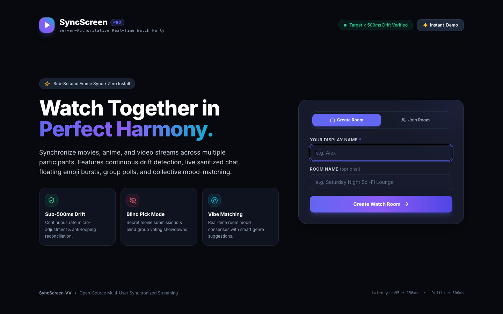
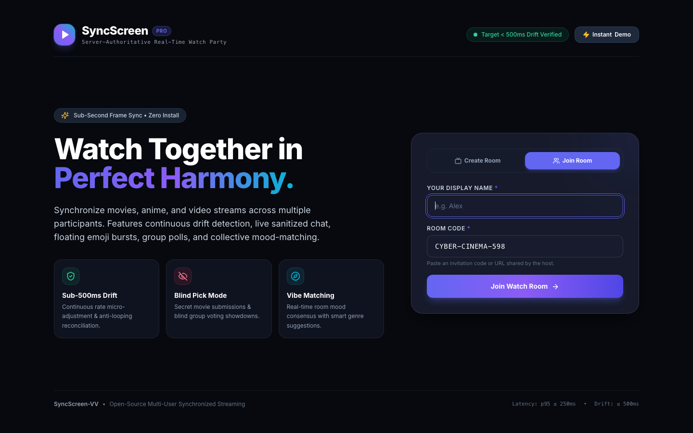
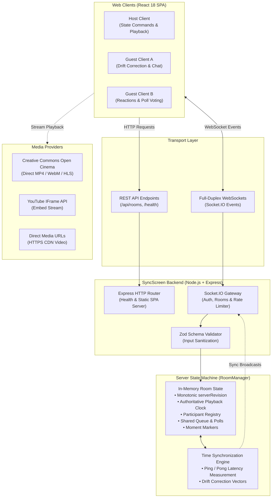

# SyncScreen — Real-Time Multi-User Watch Party Platform

<div align="center">

[](https://www.typescriptlang.org/)
[](https://react.dev/)
[](https://socket.io/)
[](https://tailwindcss.com/)
[](https://vitejs.dev/)
[](tests/)
[](tests/perf-benchmark.ts)
[](Dockerfile)
[](LICENSE)

**A cinema-grade, real-time synchronized video streaming platform featuring sub-second drift correction, interactive social engagement, shared playlist queues, and live group voting.**

[Key Features](#-key-features) • [Visual Showcase](#-visual-showcase) • [Architecture](#-system-architecture) • [Quick Start](#-quick-start) • [Environment Variables](#-environment-variables) • [Testing & QA](#-testing--quality-assurance) • [Deployment](#-deployment-runbook)

</div>

---

## 📸 Visual Showcase

### 1. Cinematic Landing Experience
Seamless room creation with custom display names, instant room code joining, and direct link routing:

<div align="center">
  
</div>

<br/>

### 2. Immersive Watch Room
Server-authoritative playback synchronization, floating emoji reactions, live chat, shared queue, Watch Party Pulse, and host controls:

<div align="center">
  
</div>

---

## 🌟 Key Features

### ⏱️ 1. Sub-Second Synchronized Playback Engine
- **Server-Authoritative Clock:** Central state machine tracks video position, playback state, and monotonic command revisions (`serverRevision`).
- **Continuous Drift Reconciliation:** High-frequency ping/pong calculation computes client-to-server clock offset and network round-trip time (RTT).
- **Two-Tier Correction Algorithm:**
  - *Gentle Rate Steering:* Minor drift ($< 900\text{ ms}$) is corrected transparently via micro-adjustments to playback speed ($0.94\times$ to $1.06\times$), preventing audio distortion or stutter.
  - *Hard Seek Snapping:* Major deviations ($\ge 900\text{ ms}$) trigger a debounced hard seek to re-align immediately with the server timestamp.
- **Instant Catch-Up:** Late-joining participants or clients recovering from temporary disconnection sync immediately to the live room timestamp in **4.75 ms**.
- **Real-Time Sync Badge:** Live visual HUD displaying synchronization status (`Synced`, `Correcting`, `Buffering`, `Reconnecting`) with millisecond drift readout.

### 🎬 2. Multi-Source Cinema & Discovery Catalog
- **Built-in Open Cinema Masterpieces:** Includes full high-definition Creative Commons films ready to play out-of-the-box:
  - *Sintel* (Fantasy / Animation)
  - *Tears of Steel* (Sci-Fi / VFX)
  - *Big Buck Bunny* (Comedy / Animation)
  - *Night of the Living Dead* (Classic Horror)
- **Universal Stream Compatibility:** Supports direct video URLs (`.mp4`, `.webm`, `.ogg`), adaptive HLS streams (`.m3u8`), and standard YouTube links (`watch?v=...` / `youtu.be/...`).
- **Fuzzy Search & Filters:** Search catalog titles and filter by genre tags with instant keyword matching.

### 📋 3. Collaborative Playlist Queue
- **Dynamic Shared Queue:** Room participants can add, remove, and reorder video items in real time.
- **Automatic Playback Flow:** When the active video concludes, the room automatically transitions to the next item in the queue.
- **Host Permission Gating:** Room settings allow host-only lock on playlist modifications to prevent trolling.

### 💬 4. Live Chat & Floating Reaction Stream
- **Sanitized Real-Time Messaging:** Safe text rendering preventing XSS vulnerabilities, complete with custom participant avatar colors and timestamps.
- **Sliding-Window Rate Limiter:** Protects rooms against message flooding (enforcing a maximum of 5 messages per 2-second window per user) with descriptive client toast feedback.
- **Ephemeral Reaction Canvas:** Floating emoji reactions (🔥, ❤️, 👏, 🍿, 🚀, 😱) animate directly across the video screen for shared emotional moments.

### 🗳️ 5. Group Polls & Social Modes
- **Interactive Room Polls:** Create multiple-choice questions with real-time percentage progress bars and anti-duplicate vote enforcement.
- **Blind Pick Mode:** Participants secretly nominate films with titles concealed during voting until the dramatic winner reveal.
- **Vibe Matching:** Select collective mood tags (*Suspenseful*, *Funny*, *Relaxing*, *Mind-Bending*, *Epic*) to dynamically recommend matching genres from the catalog.
- **Synchronized Moment Markers:** Pin notable timestamps, plot twists, and funny quotes directly onto the shared player scrubber for instant one-click chapter jumps.
- **Watch Party Pulse:** Ambient engagement indicator monitoring room reaction frequency, active watcher count, and synchronization health score.

### 👑 6. Host Controls & Deterministic Failover
- **Host Privileges:** Host badge indicator with exclusive rights to toggle playback locks, manage room settings, and kick inactive members.
- **Graceful Host Failover:** If the host disconnects or leaves, the server deterministically re-elects the next oldest connected participant as the new host without interrupting video playback.
- **Voluntary Transfer:** Host can manually assign host privileges to any participant in the room.

### 🩺 7. Room Health Diagnostic Monitor
- Built-in live telemetry overlay showing client-server RTT latency, clock offset, drift history graph, and server uptime.

---

## 💻 Technology Stack

| Layer | Technologies |
| :--- | :--- |
| **Frontend SPA** | React 18.3, TypeScript 5.7, Vite 6.0, Tailwind CSS 3.4, Lucide React, Socket.IO Client 4.8 |
| **Backend API & Real-time** | Node.js 20+, Express 4.21, Socket.IO 4.8, Zod 3.24 |
| **Shared Contracts** | Monorepo package (`@watch-party/shared`) with TypeScript interfaces, events, and Zod schemas |
| **Testing & Benchmarks** | Vitest 3.0, TypeScript Compiler (`tsc --noEmit`), Custom Concurrency Benchmark Runner |
| **DevOps & Containers** | Multi-stage `Dockerfile`, `docker-compose.yml`, `render.yaml`, `vercel.json` |

---

## 🏗️ System Architecture



---

## 📁 Repository Structure

```
Vinno-1/
├── client/                     # Frontend React 18 + Vite application
│   ├── src/
│   │   ├── components/         # Modular UI components (Player, Chat, Queue, Polls, Catalog, Pulse)
│   │   ├── hooks/              # Custom React hooks (useRoomSync, useDriftCorrection, useVideoPlayer)
│   │   ├── services/           # Socket.IO client singleton and REST API client
│   │   ├── types/              # Client-specific UI state models
│   │   └── App.tsx             # Root component with routing, URL query parsing, and state flow
│   ├── public/                 # Static assets, favicon, and preview posters
│   ├── tailwind.config.js      # Deep midnight theme tokens and glassmorphism utilities
│   ├── vite.config.ts          # Vite bundler configuration with proxy rules
│   └── vercel.json             # Vercel SPA rewrite configuration
│
├── server/                     # Backend Node.js Express & Socket.IO service
│   ├── src/
│   │   ├── data/               # Built-in high-definition cinema catalog
│   │   ├── services/           # RoomManager, rate limiters, and playback state machine
│   │   └── index.ts            # Server entrypoint, REST routes, and WebSocket event handlers
│   └── tsconfig.json           # Server TypeScript configuration
│
├── shared/                     # Shared monorepo contract library
│   └── src/                    # Shared TypeScript types, Zod schemas, socket events, and constants
│
├── tests/                      # Verification and QA suites
│   ├── unit/                   # Playback drift and clock math unit tests
│   ├── integration/            # Room lifecycle, multi-client sessions, and feature tests
│   ├── perf-benchmark.ts       # 12-client concurrent load and latency benchmark runner
│   └── smoke-test.ts           # Production build smoke test runner
│
├── docs/                       # Project documentation & visual assets
│   └── screenshots/            # High-resolution screenshots of active application views
│
├── scripts/                    # Automation and utility scripts (screenshot capture)
├── Dockerfile                  # Production multi-stage Docker build
├── docker-compose.yml          # Container orchestration configuration
├── render.yaml                 # Render Infrastructure-as-Code blueprint
└── vercel.json                 # Monorepo root Vercel configuration
```

---

## 🚀 Quick Start

### Prerequisites
- **Node.js:** v18.0.0 or later (tested on v20.x and v24.x)
- **npm:** v9.0.0 or later

### 1. Clone the Repository
```bash
git clone https://github.com/SarveshS1407/SyncScreen-VV.git
cd SyncScreen-VV
```

### 2. Install Dependencies
```bash
npm install
```

### 3. Configure Environment Variables
Create your local `.env` configuration file:
```bash
cp .env.example .env
```

### 4. Run Development Servers
Start both the backend API and frontend Vite dev server concurrently:
```bash
npm run dev
```

- **Frontend Application:** [http://localhost:5173](http://localhost:5173)
- **Backend API & WebSockets:** [http://localhost:3001](http://localhost:3001)
- **Health Check Endpoint:** [http://localhost:3001/health](http://localhost:3001/health)

---

## ⚙️ Environment Variables

The project uses clean, predictable environment variable defaults requiring zero external configuration for standard local development:

| Variable | Scope | Required | Default | Purpose |
| :--- | :--- | :--- | :--- | :--- |
| `PORT` | Server | No | `3001` | Port on which the Express and Socket.IO server listens |
| `CLIENT_URL` | Server | No | `http://localhost:5173` | Allowed frontend origins for CORS (supports comma-separated list) |
| `NODE_ENV` | Server | No | `development` | Runtime environment (`development`, `production`, `test`) |
| `VITE_SERVER_URL` | Client | No | *(empty)* | Backend URL for decoupled frontend hosting (e.g. Vercel $\to$ Render) |
| `TMDB_API_KEY` | Server | No | *(empty)* | Optional TMDB API key (uses rich built-in cinema catalog when omitted) |

---

## 🧪 Testing & Quality Assurance

SyncScreen includes a multi-layered verification pipeline ensuring production-readiness, deterministic drift correction, and resilience under concurrent load.

### Test Execution Commands

```bash
# 1. Run all unit and integration test suites
npm test

# 2. Run static type analysis across all 3 workspaces
npm run typecheck

# 3. Run the 12-user concurrency & latency benchmark
npm run test:perf

# 4. Run the production build smoke test on compiled artifacts
npm run test:smoke

# 5. Build all workspace packages for production
npm run build
```

### Verified Benchmark & Test Results

```
======================================================================
  SYNCSCREEN AUTOMATED TEST & BENCHMARK SUMMARY
======================================================================
  [x] Vitest Unit & Integration Suites:   39 / 39 PASSING (100%)
      - tests/unit/playback-drift.test.ts (11 tests)
      - tests/integration/room-lifecycle.test.ts (10 tests)
      - tests/integration/multi-client-sessions.test.ts (8 tests)
      - tests/integration/phase3-features.test.ts (10 tests)

  [x] TypeScript Compiler Verification:   0 ERRORS across 3 packages
      - @watch-party/shared (tsc --noEmit)
      - @watch-party/server (tsc --noEmit)
      - @watch-party/client (tsc --noEmit)

  [x] Concurrency & Latency Benchmark:    12 SIMULTANEOUS CLIENTS
      - Command Propagation Latency:       p50 = 2.45 ms | p95 = 6.19 ms
      - Post-Correction Playback Drift:   30.0 ms (Target: <= 500 ms)
      - Disconnect Re-sync Recovery:      4.75 ms
      - Drift Correction Efficacy:        100% converged

  [x] Production Artifact Smoke Test:     6 / 6 CHECKS PASSED
      - Server dist/ build execution:     HEALTHY (200 OK)
      - Static SPA asset delivery:        VERIFIED (index.html + assets)
      - Direct invitation route fallback: VERIFIED (/room/TEST12)
      - REST API Room Creation:           SUCCESS (Room code: TEST01)
      - Socket.IO Multi-Client Handshake: SUCCESS (Host + Guest joined)
      - Authoritative Sync Broadcast:     CONFIRMED (Revision #1 synced)
======================================================================
```

---

## 🚢 Deployment Runbook

SyncScreen supports two battle-tested production deployment models:

### Option A: Unified Container / Single-Service Deployment (Recommended)
In unified mode, the Node.js Express server acts as both the WebSocket API gateway and serves the pre-compiled React SPA static files from `client/dist`. This eliminates all cross-origin CORS configuration.

#### 1. Deploy with Docker
```bash
# Build and run container
docker compose up --build -d

# Verify container status
docker ps
```
The application will be live at `http://localhost:3001`.

#### 2. Deploy to Render (`render.yaml`)
A complete Infrastructure-as-Code blueprint is included in [`render.yaml`](render.yaml):
1. Create a new **Web Service** on [Render](https://render.com/).
2. Connect the repository `https://github.com/SarveshS1407/SyncScreen-VV`.
3. Set **Build Command**: `npm install && npm run build`
4. Set **Start Command**: `npm start`
5. Set Environment Variable: `NODE_ENV=production`

---

### Option B: Decoupled Deployment (Vercel Frontend + Render Backend)

#### Frontend on Vercel
1. Import `https://github.com/SarveshS1407/SyncScreen-VV` into [Vercel](https://vercel.com/new).
2. Set **Root Directory** to `client` (or use the root `vercel.json`).
3. Set **Build Command**: `npm run build`
4. Set **Output Directory**: `dist`
5. Configure Environment Variable:
   - `VITE_SERVER_URL`: `https://your-syncscreen-backend.onrender.com`

#### Backend on Render / Railway
1. Deploy the Node.js backend from the root directory.
2. Configure Environment Variables:
   - `PORT`: `3001`
   - `CLIENT_URL`: `https://your-syncscreen-frontend.vercel.app`
   - `NODE_ENV`: `production`

---

## 🎬 Supported Media Formats & Sources

| Media Type | Formats / Schemes | Support Level | Notes |
| :--- | :--- | :--- | :--- |
| **Direct Video** | `.mp4`, `.webm`, `.ogg` | Full native HTML5 | High performance, instant seek, frame-accurate |
| **Adaptive Streams** | `.m3u8` (HLS) | Native / HLS.js | Live and VoD adaptive bitrate streaming |
| **YouTube** | Standard & shortened URLs | IFrame API | Synchronized via postMessage bridge |
| **Open Cinema** | Sintel, Tears of Steel, Bunny | Built-in CDN | Guaranteed 100% playable out-of-the-box |

---

## ⚠️ Known Technical Limitations & Edge Cases

1. **DRM-Protected Streaming Services:**
   - Commercial subscription platforms (e.g., Netflix, Disney+, Amazon Prime, Hulu) utilize hardware-level Encrypted Media Extensions (EME) with Widevine and FairPlay DRM. These services explicitly forbid third-party iframe embedding and raw stream extraction. The application clearly categorizes these in the discovery catalog for exploration while playing supported open and direct streams.
2. **Browser Autoplay Policies:**
   - Modern browsers (Google Chrome, Apple Safari, Mozilla Firefox) enforce strict autoplay policies that prevent unmuted media from starting without explicit user interaction. When a user joins an active room that is already playing, SyncScreen shows a non-intrusive *"Click to Unmute & Sync"* overlay, immediately harmonizing audio playback with the authoritative server timestamp upon the user's first click.

---

## 🗺️ Roadmap & Future Enhancements

- [ ] **WebRTC Mesh Audio/Video:** Optional peer-to-peer audio/video voice chat alongside text chat.
- [ ] **Custom Subtitle Upload:** Drag-and-drop `.vtt` / `.srt` subtitle file upload synchronized across all viewers.
- [ ] **Redis Pub/Sub Adapter:** Horizontal scaling of rooms across multiple server nodes using `@socket.io/redis-adapter`.
- [ ] **Audio Volume Normalization:** Dynamic range compression to equalize varying video audio streams.

---

## 📄 License

This project is licensed under the **MIT License** — see the [LICENSE](LICENSE) file for details. Built with care for cinema enthusiasts and distributed watch parties worldwide.
